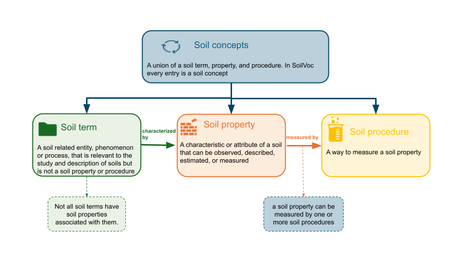

[](https://doi.org/10.5281/zenodo.19710233)

# EUSoilVoc

Harmonising terminology within or between communities is an important aspect in cooperation. The SKOS ontology is a common mechanism to advertise (and link between) terminologies.  

This repository aims to facilitate co-creation of a skos vocabulary around `soil observation data`. It includes definitions of soil properties (descriptors), indicators and observation methods. It also includes a number of tools to prepare and interact with the vocabulary:
- Tooling to [traverse to and from RDF](#traverse-tooling) (ttl) to CSV. CSV facilitates reviews by content specialists. While the RDF can be read by engines.
- A [REST API](#rest-api) to interact with the vocabulary (read only).
- A human friendly [web interface](#web-interface) to browse through the vocabulary. This website is available at [SoilVoc Viewer](https://soilwise-he.github.io/soil-vocabs/), which is also linked to [w3id.org/eusoilvoc](https://w3id.org/eusoilvoc)

## How to contribute
The current process for uploading new properties and procedures is through a [Github issue](https://github.com/soilwise-he/soil-vocabs/issues/new/choose). The workflow is displayed as below:




## Relevant terminologies

For the soil domain we should distinghuish various types of entities for which definitions can be listed.

- General glossary on soil related terms, what is soil, soil health, soil quality
- Soil **properties** / Soil health indicators to be monitored
- **Results**, in those cases that a result is a reference to a classification (low, medium, high) a proper definition of the class needs to be defined
- **Observation Procedures** describe how an observation has been performed
- The potential occurence of a soil **threat** can be determined by combining a number of indicators
- **Remediation procedures** describe how soil threats can be reduced
- Ability to perform Soil **functions** is estimated by the quality indicators
- Feature Of Interest **types**, an (set of) observation should be representative for a FOI, eg a horizon, profile, plot, site, body

## Traverse tooling

The main published vocabulary files are available in the repository root, while support tooling lives in dedicated folders:

- `scripts/restore_soilvoc_from_csv.py` rebuilds or compares `SoilVoc.ttl` from `SoilVoc_concepts.csv`
- `viewer/` contains the current browser-based viewer and its build instructions
- `legacy/static-viewer/` preserves the previous HTML viewer, JSON snapshot, and generator
- `docker/Dockerfile` builds the combined API + current viewer container

Typical local commands:

```bash
python scripts/restore_soilvoc_from_csv.py --csv SoilVoc_concepts.csv --out SoilVoc_restored.ttl --compare SoilVoc.ttl
docker build -f docker/Dockerfile -t soilvoc .
```

### CSV interchange

Cell 22 of `soil_vocabs.ipynb` contains the complete, self-contained exporter
from `SoilVoc.ttl` to `SoilVoc_concepts.csv`. The master CSV uses these columns:

```csv
id,type,prefLabel,altLabel,definition,broader,narrower,property,exactMatch,closeMatch,definitionSource,conceptSource
```

- `type` explicitly lists `skos:Concept` and, where applicable,
  `sosa:ObservableProperty` or `sosa:Procedure`. Types are not inferred from mappings.
- Relationship columns contain full concept URIs, not labels. `broader` and
  `narrower` contain only reciprocal SKOS links. `property` belongs only to
  procedures and records explicit `sosa:isProcedureFor` links; restoration also
  creates the inverse `sosa:hasProcedure`. Specialized procedures may have a
  broader procedure and no direct `property` value.
- List values use the exact separator ` | `. Escape literal pipes as `\|` and
  backslashes as `\\`. Semicolons are ordinary text. CSV quoting handles commas,
  quotes and line breaks. Literal whitespace is preserved.
- `definition` and `definitionSource` are positionally paired lists. Retain empty
  source positions, including leading/trailing ones. A missing source preserves
  a direct definition literal; a supplied source creates a definition blank node
  with `rdf:value` and `dcterms:source`. `conceptSource` records separate
  concept-level provenance.

The exporter and restoration script support the current English, single-scheme
SoilVoc profile. They reject
unsupported RDF, unknown columns, dangling references, inconsistent hierarchies
and invalid procedure links instead of silently dropping information. Scheme and
top-concept declarations are reconstructed. Comparison includes every triple,
ignores blank-node identifiers, and exits nonzero on a mismatch.

Headers `ID`, `sourceLink`/`source link` and `isProcedureFor` are accepted as
aliases for `id`, `definitionSource` and `property`. All twelve master columns
remain required: feedback templates still need a separate reviewed import step
to supply IDs/types and reconcile reciprocal links. Curated modules remain the
authoritative sources; CSV restoration is an explicitly requested operation.

`scripts/restore_soilvoc_from_csv.py` is self-contained and both restores the RDF
and verifies the serialized result against the reference vocabulary. No separate
CSV helper module or test script is required:

```bash
python scripts/restore_soilvoc_from_csv.py --csv SoilVoc_concepts.csv --out SoilVoc_restored.ttl --compare SoilVoc.ttl
```

## Rest api

A REST API for searching concepts, getting concept details and getting procedures linked to properties. Available at [SoilVoc api]([#/concepts/search_api_v1_concepts_search_get](http://api.soilwise.wetransform.eu/vocab/docs)). Read more at [api/README.md](./api/README.md).

## Web interface

A browser-based viewer to explore the complete SKOS and procedure hierarchy,
sourced definitions, types, relationships, and mappings. It reads the bundled
`skosmos/SoilVoc_skosmos.ttl` without an API or triplestore.

The [viewer source and local instructions](./viewer/README.md) are in `viewer/`.
GitHub Actions tests/builds the viewer and publishes it to
[GitHub Pages](https://soilwise-he.github.io/soil-vocabs/) when relevant files
change on `main`. The existing [W3ID entry point](https://w3id.org/eusoilvoc)
and fragment links such as [cultural services](https://w3id.org/eusoilvoc#CulturalServices)
continue to work. RDF requests still resolve to the unchanged canonical Turtle.

The previous page is retained in [legacy/static-viewer](./legacy/static-viewer/)
for reference and is not part of the new Pages build.

## Source vocabularies

Source vocabulary data is stored under [ontovocabs](./ontovocabs). Every source is retained as a SKOS Turtle file and a derived CSV label index, with columns `concept`, `prefLabel`, and `altLabels`. Multiple alternative labels are separated by semicolons; definitions, mappings, and relationships remain in the Turtle file.

## Installation instructions

The software in this repository is available as [docker image](https://github.com/soilwise-he/soil-vocabs/pkgs/container/soil-vocabs). See details of the component on how to run the utility. 

---

## Soilwise-he project
This work has been initiated as part of the [Soilwise-he](https://soilwise-he.eu) project. The project receives
funding from the European Union’s HORIZON Innovation Actions 2022 under grant agreement No.
101112838. Views and opinions expressed are however those of the author(s) only and do not necessarily
reflect those of the European Union or Research Executive Agency. Neither the European Union nor the
granting authority can be held responsible for them.
